# FLASHBACK // LIVE — Architecture Specification

This document outlines the architectural blueprint, technology selection rationale, database schema, and real-time event pipeline for **FLASHBACK // LIVE**.

---

## 1. Tech Stack Rationale

```
+---------------------------------------------------------------------------------+
|                                 CLIENT LAYER                                    |
|   Mobile Guest Portal (/)                     Smart TV / Projector (/display)   |
|   Vanilla HTML5 / Modern CSS3                 Vanilla HTML5 / Modern CSS3       |
|   ES6+ JavaScript (upload.js)                 ES6+ JavaScript (display.js)      |
+---------------------------------------+-----------------------------------------+
                                        | HTTP / SSE
+---------------------------------------v-----------------------------------------+
|                                BACKEND LAYER                                    |
|                       FastAPI (ASGI) + Uvicorn Worker                           |
|      - Routing & Templating                   - Magic-Byte & Pillow Validation  |
|      - SSEBroadcaster (asyncio.Queue)         - CORS & Network Discovery        |
+---------------------------------------+-----------------------------------------+
                                        | SQLAlchemy ORM
+---------------------------------------v-----------------------------------------+
|                              PERSISTENCE LAYER                                  |
|     SQLite (flashback.db)                     Local Storage (/uploads)          |
|     - visitors table                          - UUID4-named images              |
|     - photos table                                                              |
+---------------------------------------------------------------------------------+
```

### Backend: FastAPI & Uvicorn (Python)
- **Native Async I/O:** FastAPI is built on Starlette and AnyIO, enabling asynchronous event handling without thread-blocking. This allows a single lightweight server process to maintain hundreds of persistent HTTP Server-Sent Events connections.
- **Type Safety & Auto-Documentation:** Pydantic schemas enforce strict data contracts with automatic OpenAPI (Swagger) documentation available out of the box at `/docs`.
- **Zero Heavy Orchestration:** Python's standard library combined with lightweight dependencies (`sqlalchemy`, `python-multipart`, `pillow`) eliminates the operational overhead of message brokers (e.g., Redis or RabbitMQ) for self-contained event setups.

### Real-Time Transport: Server-Sent Events (SSE)
- **Why SSE Over WebSockets?**
  - **Unidirectional Efficiency:** The TV display only needs to *receive* photos and like events from the server; it does not need to publish back over the same socket. SSE is tailored for unidirectional server-to-client streaming.
  - **Native HTTP/HTTPS:** SSE operates over standard HTTP/1.1 or HTTP/2 (`text/event-stream`), bypassing WebSocket handshake upgrades and corporate firewall/proxy restrictions common in event venues.
  - **Automatic Reconnection:** Browsers natively manage SSE connection health with exponential backoff and connection re-establishment via the standard `EventSource` API.

### Frontend: Vanilla HTML5, CSS3 & ES6+ JavaScript
- **Zero Build Friction:** No `node_modules`, Webpack, Vite, or Babel steps required. The application runs immediately upon server start.
- **Hardware-Accelerated CSS:** Modern CSS animations (`@keyframes` for Ken Burns zoom/pan and floating hearts) run directly on the GPU compositor thread, ensuring smooth 60fps animations even on lower-powered Smart TV browsers.
- **CSS Custom Properties & Glassmorphism:** Shared CSS design tokens allow theme consistency across both mobile viewports and 4K displays.

### Persistence: SQLite with SQLAlchemy ORM
- **Zero Configuration:** Single-file database (`flashback.db`) that requires no daemon setup or external network configuration.
- **High Concurrency for Events:** Using WAL mode and `check_same_thread=False` allows concurrent reads and rapid serialized writes well beyond the requirements of single-venue events.

---

## 2. Database Schema (SQLite)

The database schema manages visitor identities and photo assets through normalized relational tables:

```
+--------------------------------+          +--------------------------------------+
|            visitors            |          |                photos                |
+--------------------------------+          +--------------------------------------+
| id (PK, Integer, AutoInc)      |<----+    | id (PK, Integer, AutoInc)            |
| guest_name (String(100), Index)|     |    | visitor_id (FK -> visitors.id, Index)|
| ip_address (String(50))        |     +----| filename (String(255), Unique, Index)|
| created_at (DateTime, Index)   |          | original_filename (String(255))      |
+--------------------------------+          | guest_name (String(100))             |
                                            | caption (String(500), Nullable)      |
                                            | filter_applied (String(50))          |
                                            | file_size (Integer)                  |
                                            | mime_type (String(100))              |
                                            | likes_count (Integer, Default: 0)    |
                                            | created_at (DateTime, Index)         |
                                            +--------------------------------------+
```

### Table 1: `visitors`
Stores individual attendee identities associated with photo submissions.

| Column | Type | Constraints | Description |
|---|---|---|---|
| `id` | `INTEGER` | Primary Key, Autoincrement | Unique visitor identifier |
| `guest_name` | `VARCHAR(100)` | Not Null, Indexed | Display name or handle chosen by attendee |
| `ip_address` | `VARCHAR(50)` | Nullable | Client IP address for basic audit and rate-limiting |
| `created_at` | `DATETIME` | Not Null, Indexed | Timestamp of visitor's initial submission |

### Table 2: `photos`
Stores metadata, file references, aesthetic tags, and engagement counters for each memory.

| Column | Type | Constraints | Description |
|---|---|---|---|
| `id` | `INTEGER` | Primary Key, Autoincrement | Unique photo identifier |
| `visitor_id` | `INTEGER` | Foreign Key (`visitors.id`), Indexed | References the uploading visitor |
| `filename` | `VARCHAR(255)` | Not Null, Unique, Indexed | Sanitized UUID4 filename stored on disk |
| `original_filename` | `VARCHAR(255)` | Not Null | Original file name from client device |
| `guest_name` | `VARCHAR(100)` | Not Null | Denormalized visitor name for instant query rendering |
| `caption` | `VARCHAR(500)` | Nullable | Optional text shoutout or caption |
| `filter_applied` | `VARCHAR(50)` | Not Null, Default: `'normal'` | Aesthetic filter (cyber, vintage, noir, sunset) |
| `file_size` | `INTEGER` | Not Null | Image size in bytes |
| `mime_type` | `VARCHAR(100)` | Not Null | Verified MIME type (`image/jpeg`, `image/png`, etc.) |
| `likes_count` | `INTEGER` | Not Null, Default: `0` | Live heart reaction counter |
| `created_at` | `DATETIME` | Not Null, Indexed | UTC timestamp of upload |

---

## 3. End-to-End Real-Time Sequence Diagram

The following Mermaid sequence diagram illustrates the lifecycle of a photo capture, validation, storage, and instantaneous SSE broadcast to connected TV displays:

```mermaid
sequenceDiagram
    autonumber
    actor Guest as Mobile Guest (Phone)
    participant UI as upload.js (/portal)
    participant API as FastAPI Backend (/api)
    participant Validator as Security & Validation
    participant DB as SQLite (visitors & photos)
    participant Broadcaster as SSE Broadcaster (asyncio)
    participant TV as display.js (Smart TV /display)

    Note over TV, Broadcaster: TV opens /display and connects to /api/stream
    TV->>API: GET /api/stream
    API->>Broadcaster: subscribe(queue)
    Broadcaster-->>TV: event: connected (Handshake OK)

    Note over Guest, UI: Guest captures photo, enters name & checks consent
    Guest->>UI: Selects photo, filter & checks "Consent"
    Guest->>UI: Taps "Broadcast to Big Screen"
    UI->>UI: Validates file size (<= 5MB) & Consent Checked

    UI->>API: POST /api/upload (multipart/form-data)
    
    rect rgb(20, 25, 45)
        Note over API, Validator: Server Validation Pipeline
        API->>Validator: Verify consent === True
        API->>Validator: Check file extension (.jpg, .png, .webp)
        API->>Validator: Check byte count <= 5MB
        API->>Validator: Inspect magic bytes (SOI / PNG / RIFF)
        API->>Validator: Pillow Image.verify() integrity check
        Validator-->>API: Validation Passed
    end

    API->>API: Generate UUID4 filename (e.g. 3a7b...jpg)
    API->>API: Write file to /uploads/ directory
    API->>DB: Upsert Visitor & Insert Photo record
    DB-->>API: Committed (Photo ID: #42)

    API->>Broadcaster: broadcast("new_photo", photo_dict)
    
    par Async Fan-Out
        Broadcaster-->>TV: event: new_photo {id: 42, url: "/uploads/3a7b...", guest: "Sarah", ...}
        API-->>UI: HTTP 201 Created (JSON Response)
    end

    UI->>UI: Display Success Screen ("Live on Big Screen!")
    
    rect rgb(30, 20, 45)
        Note over TV: TV Slideshow Spotlight Interruption
        TV->>TV: Trigger "NEW PHOTO INCOMING" Spotlight Banner
        TV->>TV: Interrupt carousel & switch active slide to #42
        TV->>TV: Apply Ken Burns pan/zoom + blurred ambient background
        TV->>TV: Hold for 9s hero duration, then resume FIFO cycle
    end
```



